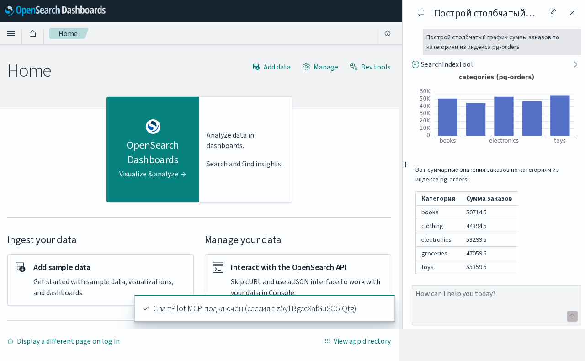
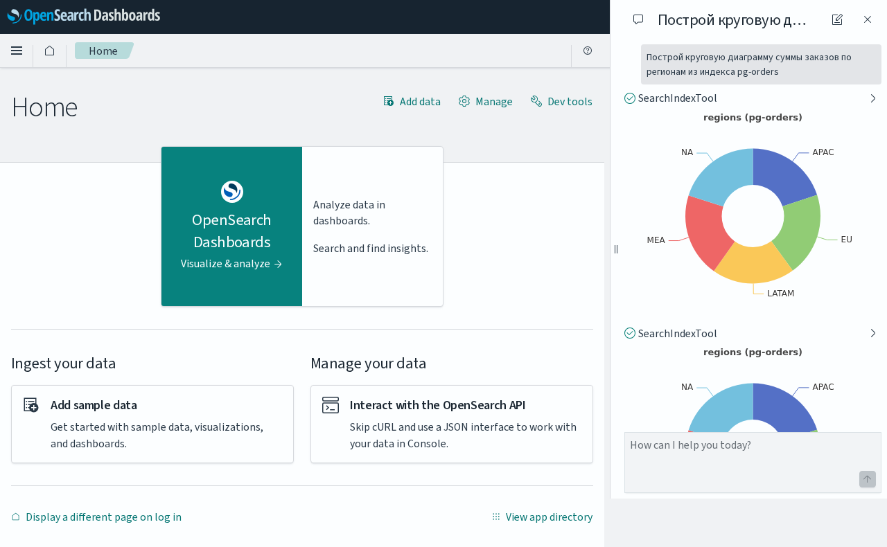
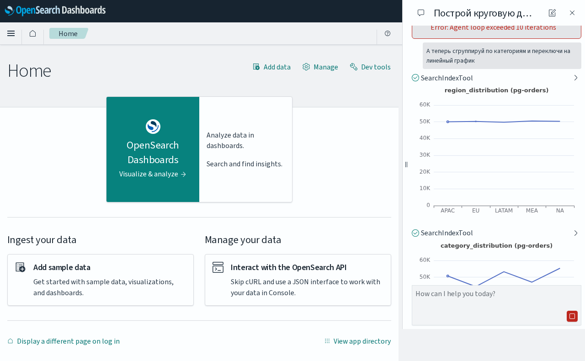
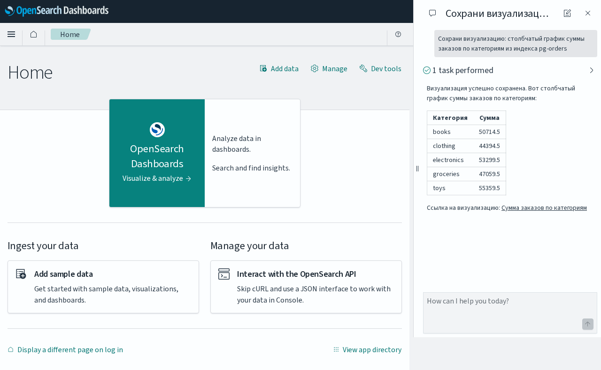

# Examples

Real screenshots from the automated E2E suite (headless Chromium + MCP client + real LLM),
taken against the Minikube stand. Prompts are sent from the terminal via `requestChart`;
everything below renders in the built-in AG-UI chat of OpenSearch Dashboards.

## 1. Inline bar chart from a terminal prompt

Prompt: *«Построй столбчатый график суммы заказов по категориям из индекса pg-orders»*

The chat panel opens automatically, the agent aggregates `pg-orders` and an inline
ECharts bar chart appears together with the numeric answer.

## 2. Multi-turn: pie by regions, then switch to line by categories

Turn 1: *«Построй круговую диаграмму суммы заказов по регионам из индекса pg-orders»*

Turn 2 (same session, history preserved): *«А теперь сгруппируй по категориям и переключи на линейный график»*

## 3. Save flow: saved visualization + public link + numbers

Prompt: *«Сохрани визуализацию: столбчатый график суммы заказов по категориям из индекса pg-orders»*

The agent creates a saved OSD visualization and answers with the numeric summary **and**
a clickable public link; opening it shows the chart with the 30-day time range restored.

---

Все скриншоты получены автоматизированным E2E-сьютом (headless Chromium + MCP-клиент + реальный LLM)
на стенде Minikube. Промпты отправляются из терминала через `requestChart`; всё отображается
во встроенном AG-UI чате OpenSearch Dashboards: inline-графики ECharts (bar/pie/line),
multi-turn с сохранением истории и save-flow со сохранённой визуализацией, числами и публичной ссылкой.